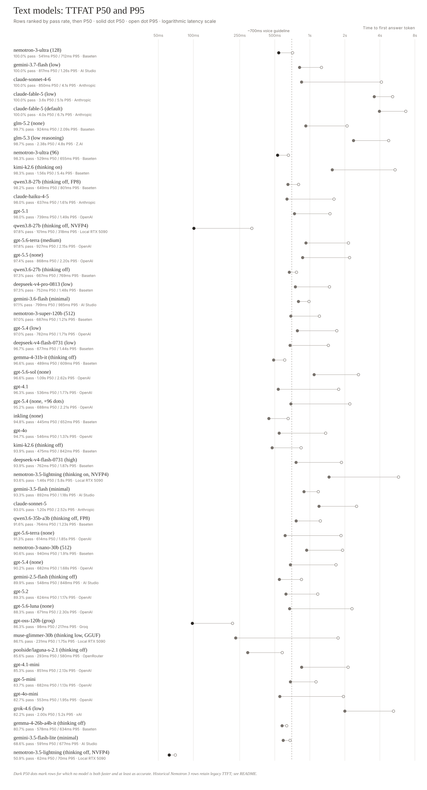
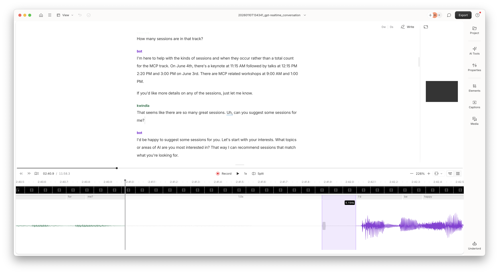

# Multi-Turn Eval

A framework for evaluating multi-turn LLM conversations with support for text, realtime audio, and speech-to-speech models.

The two benchmarks here in this public repo are:

- `aiwf_long_context` - older long-context benchmark described [here](https://post-training.aitinkerers.org/p/your-conversation-is-out-of-distribution)
- `aiwf_medium_context` - newer medium-context benchmark

Thank you to [Modal](https://modal.com/) for providing compute resources for this benchmark. And to [Charles Frye](https://x.com/charles_irl/) for advice about models and inference tuning.

## aiwf_medium_context results summary for selected models

Text mode models:

The standalone copy is [leaderboard-medium-context.md](leaderboard-medium-context.md).



Rows are ordered by available pass rate descending, then TTFAT P50 ascending. Rows with unavailable quality appear last; N counts selected complete conversations.

| Model | Pass Rate | Any Error | Tool Error | Instruction Error | KB Error | TTFAT P50 | TTFAT P95 | TTFAT Max | Provider | N |
|---|---:|---:|---:|---:|---:|---:|---:|---:|---:|---:|
| muse-spark-1.3 (low) | 100.0% | 0.0% | 0.0% | 0.0% | 0.0% | 2965ms | 9143ms | 34777ms | OpenRouter / Meta | 30 |
| gemini-3.7-flash (low) | 99.9% | 0.1% | 0.1% | 0.0% | 0.0% | 821ms | 1656ms | 15353ms | AI Studio | 30 |
| claude-sonnet-5-5 (low) | 99.9% | 0.1% | 0.0% | 0.0% | 0.1% | 838ms | 2140ms | 4546ms | Anthropic | 30 |
| gpt-5.6-terra (medium) | 99.9% | 0.1% | 0.0% | 0.1% | 0.0% | 1004ms | 1569ms | 4177ms | OpenAI | 26 |
| claude-sonnet-5-5 (no up-front thinking, low) | 99.9% | 0.1% | 0.0% | 0.0% | 0.1% | 1180ms | 2195ms | 8186ms | Anthropic | 30 |
| gemini-3.8-flash (low) | 99.9% | 0.1% | 0.0% | 0.0% | 0.1% | 1411ms | 1967ms | 7588ms | AI Studio | 30 |
| muse-spark-1.3 (minimal) | 99.6% | 0.4% | 0.1% | 0.3% | 0.0% | 1752ms | 5638ms | 40044ms | OpenRouter / Meta | 30 |
| kimi-k2.6 (thinking on) | 98.8% | 1.2% | 0.9% | 0.1% | 0.2% | 1560ms | 5393ms | 13622ms | Baseten | 30 |
| deepseek-v4-flash-0731 (high) | 98.6% | 1.4% | 0.4% | 0.9% | 0.8% | 773ms | 1970ms | 8702ms | Baseten | 30 |
| deepseek-v4-pro-0813 (low) | 98.4% | 1.6% | 0.1% | 1.1% | 1.2% | 755ms | 1474ms | 4506ms | Baseten | 30 |
| gpt-5.5 (none) | 98.2% | 1.8% | 1.8% | 1.8% | 0.0% | 780ms | 1173ms | 2870ms | OpenAI | 29 |
| gpt-5.4 (low) | 97.7% | 2.3% | 2.0% | 2.1% | 0.0% | 932ms | 1458ms | 5712ms | OpenAI | 30 |
| glm-5.3 (low reasoning) | 97.7% | 2.3% | 1.0% | 1.0% | 0.7% | 2376ms | 4757ms | 8007ms | Z.AI | 30 |
| deepseek-v4-flash-0731 (low) | 97.3% | 2.7% | 1.7% | 2.1% | 0.8% | 689ms | 1648ms | 17531ms | Baseten | 30 |
| claude-haiku-5-5 (low) | 97.2% | 2.8% | 2.2% | 1.3% | 0.2% | 651ms | 1563ms | 3717ms | Anthropic | 30 |
| gpt-5.6-sol (none) | 96.9% | 3.1% | 3.1% | 3.1% | 0.0% | 765ms | 1298ms | 36309ms | OpenAI | 28 |
| muse-spark-open (low, NVFP4) | 96.7% | 3.3% | 1.9% | 2.3% | 1.1% | 626ms | 1299ms | 3273ms | Baseten | 30 |
| gemma-4-31b-it (thinking off) | 96.4% | 3.6% | 3.3% | 3.6% | 0.0% | 497ms | 629ms | 33254ms | Baseten | 30 |
| gpt-5.4 (none, +96 dots) | 96.4% | 3.6% | 3.3% | 3.6% | 0.0% | 813ms | 1234ms | 4180ms | OpenAI | 30 |
| qwen3.8-27b (thinking off, FP8) | 96.0% | 4.0% | 1.6% | 3.7% | 0.6% | 649ms | 801ms | 2161ms | Baseten | 30 |
| gpt-4.1 | 95.9% | 4.1% | 3.5% | 4.1% | 0.0% | 743ms | 1086ms | 4655ms | OpenAI | 26 |
| glm-5.2 (none) | 95.8% | 4.2% | 0.1% | 2.3% | 2.1% | 938ms | 2215ms | 7567ms | Baseten | 30 |
| qwen3.8-27b (thinking off, NVFP4) | 95.1% | 4.9% | 1.9% | 4.7% | 0.4% | 101ms | 318ms | 592ms | Local RTX 5090 | 30 |
| gemini-3.6-flash (minimal) | 95.1% | 4.9% | 2.3% | 4.1% | 1.4% | 808ms | 1078ms | 2229ms | AI Studio | 30 |
| claude-haiku-5-5 (thinking off, low) | 94.7% | 5.3% | 3.7% | 5.2% | 0.2% | 556ms | 819ms | 2688ms | Anthropic | 29 |
| gemini-3.5-flash (minimal) | 94.7% | 5.3% | 0.4% | 5.2% | 2.0% | 898ms | 1256ms | 2076ms | AI Studio | 30 |
| inkling (none) | 94.4% | 5.6% | 2.6% | 4.4% | 1.6% | 443ms | 658ms | 1158ms | Baseten | 30 |
| gemini-3.5-flash-lite (minimal) | 94.3% | 5.7% | 4.1% | 4.3% | 1.1% | 617ms | 1145ms | 1938ms | AI Studio | 30 |
| gpt-5.1 | 93.5% | 6.5% | 2.0% | 5.2% | 1.9% | 768ms | 1493ms | 5561ms | OpenAI | 25 |
| gpt-5.4 (none) | 93.0% | 7.0% | 6.6% | 7.0% | 0.0% | 810ms | 1257ms | 3669ms | OpenAI | 30 |
| gpt-5.6-terra (none) | 92.7% | 7.3% | 7.1% | 7.3% | 0.0% | 826ms | 1257ms | 2706ms | OpenAI | 26 |
| qwen3.6-27b (thinking off) | 92.1% | 7.9% | 1.8% | 6.0% | 1.0% | 665ms | 765ms | 1920ms | Baseten | 30 |
| gpt-6-luna (low) | 91.8% | 8.2% | 4.5% | 7.2% | 0.1% | 917ms | 1439ms | 3585ms | OpenAI | 29 |
| nemotron-3-ultra (thinking on) | 91.8% | 8.2% | 0.1% | 4.2% | 5.0% | 926ms | 2116ms | 8679ms | Baseten | 30 |
| nemotron-3-super-120b (512, NVFP4) | 90.9% | 9.1% | 1.2% | 7.4% | 3.9% | 669ms | 1383ms | 2881ms | AWS B200 | 30 |
| kimi-k2.6 (thinking off) | 88.7% | 11.3% | 6.2% | 10.4% | 3.6% | 481ms | 850ms | 4458ms | Baseten | 30 |
| gpt-4o | 88.2% | 11.8% | 3.3% | 11.8% | 1.8% | 556ms | 1319ms | 5313ms | OpenAI | 11 |
| gpt-5.2 | 87.3% | 12.7% | 10.3% | 12.1% | 0.6% | 648ms | 1192ms | 7647ms | OpenAI | 11 |
| muse-glimmer-30b (thinking low, GGUF) | 85.1% | 14.9% | 12.7% | 14.9% | 0.6% | 225ms | 1743ms | 4792ms | Local RTX 5090 | 30 |
| gpt-5.6-luna (none) | 84.4% | 15.6% | 11.0% | 15.6% | 0.4% | 708ms | 1198ms | 4546ms | OpenAI | 27 |
| nemotron-3.5-lightning (thinking on, NVFP4) | 83.9% | 16.1% | 2.0% | 7.8% | 10.3% | 1470ms | 5927ms | 29869ms | Local RTX 5090 | 30 |
| gemma-4-26b-a4b-it (thinking off) | 83.4% | 16.6% | 13.4% | 16.6% | 0.1% | 578ms | 680ms | 31574ms | Baseten | 30 |
| gpt-4o-mini | 83.0% | 17.0% | 10.3% | 13.9% | 4.8% | 603ms | 3367ms | 16315ms | OpenAI | 11 |
| qwen3.6-35b-a3b (thinking off, FP8) | 82.6% | 17.4% | 5.6% | 15.7% | 3.7% | 762ms | 1134ms | 14389ms | Baseten | 30 |
| gpt-4.1-mini | 81.8% | 18.2% | 13.1% | 18.2% | 0.8% | 638ms | 1010ms | 1704ms | OpenAI | 13 |
| gemini-2.5-flash (thinking off) | 81.4% | 18.6% | 9.2% | 18.3% | 2.8% | 545ms | 824ms | 2352ms | AI Studio | 30 |
| gpt-5-mini | 80.9% | 19.1% | 13.9% | 18.8% | 0.9% | 690ms | 1191ms | 2269ms | OpenAI | 11 |
| poolside/laguna-s-2.1 (thinking off) | 79.3% | 20.7% | 9.7% | 16.1% | 7.2% | 296ms | 600ms | 3140ms | OpenRouter | 29 |
| nemotron-3-nano-30b (512, NVFP4) | 71.9% | 28.1% | 7.6% | 13.3% | 18.6% | 934ms | 1436ms | 1538ms | AWS B200 | 7 |
| nemotron-3.5-lightning (thinking off, NVFP4) | 69.6% | 30.4% | 12.7% | 22.3% | 10.6% | 63ms | 70ms | 80ms | Local RTX 5090 | 16 |

Every new grade uses **Opus 5.5 at medium effort**, with the same frozen text rubric. **— means full-cohort quality is unavailable because the provider rejected at least one selected input**; those rows remain visible with recalculated latency. Rejected judge requests are neither model failures nor passing grades, and their conversations are not dropped to manufacture a score. **N is complete conversations**, with 30 scripted turns each. The historical refresh selected the most recent matching complete conversations, up to 30 per configuration. Fresh Ultra, the October 18 new-model cohorts, and the Responses adapter refresh are prospective; their linked reports give assignment and completion policies. 17 ranked rows have fewer than 30; the [cohort audit](docs/text-cohort-sizes-2026-10-17.md) explains the shortfalls. Selection does not require correct tools or a passing grade.

Accuracy is **conditional on completion**. Incomplete conversations and their observed prefixes are excluded, so these results differ from earlier attempt-based, fixed-900-turn studies. They measure quality among completed conversations and do not establish completion reliability. Any Error is the complement of Pass Rate; component errors overlap. The [refresh report](docs/model-evaluations-2026-10/judge-refresh-opus55-20261017/REPORT.md) includes exact counts, conversation-cluster confidence intervals, selected source dates, and configuration mappings.

Judge inputs exclude delimited `<think>` reasoning, including analysis before a closing `</think>` whose opening tag was supplied by the chat template. Final answers and actual tool calls are evaluated; raw captures are preserved. The [cleanup summary](docs/model-evaluations-2026-10/judge-refresh-opus55-20261017/reasoning-cleanup/manifest.json) describes the normalization; the full per-input audit is preserved in the [local evidence archive](docs/model-evaluations-2026-10/README.md). Historical latency measurements are unchanged; leaked reasoning in content may have started their timer before the final answer.

TTFAT is the recorded service time to the first user-visible answer token or tool-call output. Each conversation's first scripted response is excluded; later scripted and recovery responses are included. P95 uses linear interpolation. All latency cells were recalculated from the selected captures. Local GPU measurements use localhost and omit provider network time; capture dates, SDK versions, hardware, caching, and sampling settings differ across rows. OpenAI cohorts retain recorded service-tier/SDK variation; older unlogged tiers are not inferred as defaults. The ~700ms line is a voice-use guideline, not a statistical threshold or a measured end-to-end speech latency.

The published Nemotron 3 Ultra row uses **30 fresh thinking-on conversations on Baseten**, with `reasoning_effort=high`, temperature 1.0, top-p 0.95, and max_tokens 16384; all 30 completed. No numeric thinking budget was requested. This replaces the older Modal 128/96 rows. Thinking-off is omitted from the current leaderboard; the completed comparison, original grades, and early-ending runs remain in the [Ultra study](docs/model-evaluations-2026-10/baseten-nemotron-ultra/aiewf-medium-off-on-n30-20261018/REPORT.md). Three-second request pacing occurs before latency measurement. Super/Nano 512 retain their mapped **NVFP4 on AWS B200** cohorts. The [failure audit](docs/model-evaluations-2026-10/baseten-nemotron-ultra/aiewf-medium-off-on-n30-20261018/failure-analysis/REPORT.md) and [same-output rubric comparison](docs/model-evaluations-2026-10/baseten-nemotron-ultra/aiewf-medium-off-on-n30-20261018/rubric-comparison/REPORT.md) explain the current score. The [earlier configuration inventory](docs/model-evaluations-2026-10/judge-refresh-opus55-20261017/configurations.json) and [source audit](docs/model-evaluations-2026-10/judge-refresh-opus55-20261017/SOURCE-AUDIT.md) preserve the retired Ultra cohorts; they are historical evidence.

Reasoning, filler, precision, and serving configurations are kept separate. Gemini minimal/low labels retain their recorded thinking settings; Gemini 2.5 explicitly uses budget zero. Kimi on/off retain their different vendor-mode samplers. Muse uses its recorded GGUF low-strength configuration; Lightning and local Qwen use NVFP4. The manifests preserve available request settings and endpoint origins; missing settings are not inferred as defaults.

Earlier scores, denominators, serving details and study links are preserved in the [local evidence archive](docs/model-evaluations-2026-10/README.md), under `ops/judge-refresh-opus55-20261017/historical/README.md`. The [October latency audit](docs/ttfat-reanalysis-2026-10/REPORT.md) and original campaign reports remain historical evidence. The requested Groq, Grok 4.6 text, Fable, Sonnet 4.6, Haiku 4.5, and Sonnet 5 removals remain in the [row archive](docs/text-rows-archived-2026-10-17.md) and [Groq archive](docs/groq-gpt-oss-120b-archived-2026-10-17.md).

<!-- recent-models-20261018:start -->
The [October 18 new-model campaign](docs/model-evaluations-2026-10/recent-models-20261018/REPORT.md) adds GPT-6 Luna, Sonnet/Haiku 5.5, Muse Spark 1.3, and Muse Spark Open at the approved lowest reasoning settings. Each text configuration has 30 assigned conversations. The table reports completed-conversation quality and latency; the campaign report also gives completion counts and fixed-denominator scores, retaining premature endings. Sonnet’s “no up-front thinking” uses `between_tools`, with low effort; it can still emit tool progress updates. Spark 1.3 is routed through OpenRouter pinned to Meta; Spark Open uses Baseten NVFP4. OpenAI requested Priority; direct probes reported effective Fast service.
<!-- recent-models-20261018:end -->

<!-- luna-responses-integration-20261018:start -->
The earlier GPT-6 Luna captures used a defective Responses history adapter. Current affected OpenAI rows now use the [repaired adapter refresh](docs/model-evaluations-2026-10/responses-repair-20261018/REPORT.md); the [original investigation](docs/model-evaluations-2026-10/luna-completion-investigation-20261018/REPORT.md) remains available. The repair preserves native phases and reasoning, but early model endings can still occur.
<!-- luna-responses-integration-20261018:end -->

<!-- responses-repair-20261018:start -->
The [Responses adapter refresh](docs/model-evaluations-2026-10/responses-repair-20261018/REPORT.md) replaces twelve affected configurations using 30 fresh assignments each, Opus 5.5 Medium judging, and recalculated latency. Ordinary conversations use cloud-linked native history; the +96 dots arm replays native outputs with earlier user text filler-free. These are independent prospective cohorts, explicitly requesting Priority; older tiers varied or were unlogged. The table remains conditional on completion. All early endings and missing future turns are retained in the report’s fixed-900 scores.

| Configuration | Complete / assigned | Fixed-900 pass |
|---|---:|---:|
| gpt-4.1-mini | 13/30 | 76.4% |
| gpt-4.1 | 26/30 | 95.6% |
| gpt-5.4 (low) | 30/30 | 97.7% |
| gpt-5.4 (none, +96 dots) | 30/30 | 96.4% |
| gpt-5.4 (none) | 30/30 | 93.0% |
| gpt-5.5 (none) | 29/30 | 97.8% |
| gpt-5.6-luna (none) | 27/30 | 81.7% |
| gpt-5.6-sol (none) | 28/30 | 92.4% |
| gpt-5.6-terra (medium) | 26/30 | 99.0% |
| gpt-5.6-terra (none) | 26/30 | 87.2% |
| gpt-6-luna (none) | 0/30 | 25.0% |
| gpt-6-luna (low) | 29/30 | 91.8% |

Zero-completion configurations are unranked; completed-only quality and latency are unavailable.
<!-- responses-repair-20261018:end -->

<!-- recovery-context-20261019:start -->
The [recovery-context migration](docs/model-evaluations-2026-10/judge-recovery-context-20261019/REPORT.md) retains all public recovery exchanges and recorded tool outcomes as unscored chronological evidence. Opus 5.5 Medium rejudged all 698 affected active assignments; 988 byte-identical requests reuse their verified prior grades. Scoring still uses only the original scripted turns, and later recovery does not erase an earlier unnecessary deferral. The 24-conversation text/voice validation used independent Astra/Fable reference labels and two diagnostic repetitions; these are model reviews, not human ground truth or a population accuracy estimate. Generation cohorts, completion counts, latency and audio evidence are unchanged. Current exact scores and confidence intervals are in the [reconciled aggregate](docs/model-evaluations-2026-10/judge-recovery-context-20261019/summary.json); earlier linked studies preserve historical grades.
<!-- recovery-context-20261019:end -->

Speech-to-speech models:

**New quality grades use Opus 5.5 at medium effort**, using the shared frozen speech rubric. Each row has **25 complete, harness-valid conversations (750 turns)** from the latest validated capture profile. Standard rows use the speech-v2 prompt; prompt-optimized rows are marked with an asterisk. Quality is scored on recorded spoken responses, with verified audio turn-taking evidence carried forward separately.

Accuracy is conditional on completion. The original attempt ledger retains **245 attempts: 225 scored, six model/service failures, and 14 harness exclusions**. Failure rate divides incomplete model/service conversations by harness-valid attempts; top-ups do not erase failures. Original captures, prompts, alignment decisions, and September reports are preserved. See the [refresh report](docs/model-evaluations-2026-10/judge-refresh-opus55-20261017/REPORT.md) and [original sampling and capture protocol](docs/speech-results-2026-09/PROTOCOL.md).

| Model | Selected | Failed conversations | Pass Rate | Tool Use | Instruction | KB Ground | Turn Ok | Non-Tool V2V Med | Non-Tool V2V Max | Tool V2V Mean | Silence Pad Mean |
|---|---:|---:|---:|---:|---:|---:|---:|---:|---:|---:|---:|
| Nova 2.5 Sonic prompt-optimized* | 25 | 1/26 (3.8%) | 97.7% | 739/750 | 739/750 | 746/750 | 750/750 | 1088ms | 1984ms | 1412ms | 165ms |
| GPT-Live prompt-optimized + Terra medium* | 25 | 2/27 (7.4%) | 94.3% | 748/750 | 707/750 | 744/750 | — | 2144ms | 29056ms | 2471ms | — |
| GPT-Realtime-2.1 low | 25 | 0/25 (0.0%) | 93.2% | 733/750 | 706/750 | 722/750 | 750/750 | 1568ms | 9568ms | 1499ms | 75ms |
| Grok Voice 3.0 (reasoning high) | 25 | 0/25 (0.0%) | 92.8% | 750/750 | 697/750 | 729/750 | 748/750 | 1984ms | 4576ms | 2056ms | 98ms |
| GPT-Realtime-1.5 | 25 | 0/25 (0.0%) | 92.5% | 739/750 | 696/750 | 722/750 | 737/750 | 1120ms | 3424ms | 1890ms | 160ms |
| Grok Voice Think Fast | 25 | 0/25 (0.0%) | 92.1% | 740/750 | 691/750 | 746/750 | 730/750 | 2496ms | 5984ms | 2689ms | 88ms |
| GPT-Live standard + Terra medium | 25 | 0/25 (0.0%) | 91.9% | 722/750 | 696/750 | 738/750 | 749/750 | 1696ms | 11072ms | 2169ms | — |
| Grok Voice 3.0 (reasoning off) | 25 | 1/26 (3.8%) | 89.7% | 737/750 | 680/750 | 719/750 | 748/750 | 2016ms | 4384ms | 2418ms | 94ms |
| Gemini 3.8 Extended Thinking low | 25 | 0/25 (0.0%) | 89.6% | 744/750 | 673/750 | 725/750 | 750/750 | 1440ms | 8896ms | 1509ms | — |
| Gemini 3.8 Live (regular; default) | 25 | 1/26 (3.8%) | 89.5% | 719/750 | 688/750 | 726/750 | 749/750 | 1440ms | 12288ms | 2112ms | — |
| Nova 2.5 Sonic (reference in USER context) | 25 | 0/25 (0.0%) | 86.0% | 676/750 | 658/750 | 750/750 | 750/750 | 1120ms | 1888ms | 1485ms | 181ms |
| Gemini 3.1 minimal | 25 | 1/26 (3.8%) | 83.7% | 718/750 | 630/750 | 723/750 | 750/750 | 1344ms | 3936ms | 1661ms | 98ms |

<!-- nova25-user-context-20261019:start -->
**Nova Sonic content filter:** Nova Sonic applies a service-level safety filter to SYSTEM prompts before they reach the model, and two knowledge-base passages produced false positives: the sponsor name `Replicate` and the session title “Voice Cloning and Synthesis: Ethics and Technology”. Benign text of the full prompt’s length passed, and removing only those two passages let the full prompt through. To keep every reference fact, the Nova 2.5 Sonic rows send the unchanged speech-v2 policy as SYSTEM and the complete, unchanged knowledge base as a USER history message; in this layout the model answers questions about both passages correctly. This provider message-layout difference is explicit. The filter probes are excluded diagnostics, separate from the 25/25 completed scored conversations.

**Nova Sonic failure breakdown:** Of 105 failing turns (86.0% strict pass across 750 turns), 74 (70.5%) omitted required tool calls: 25 session endings, 17 votes, and 32 session suggestions, dietary requests or support tickets. Many responses claimed success without executing the action, also failing instruction following. Eight of 25 conversations made no tool calls. The remaining 31 failing turns failed only instruction following; KB grounding and audio turn-taking each passed 750/750.

The [Nova Sonic report](docs/model-evaluations-2026-10/nova-2-5-sonic-20261019/user-context-v2/REPORT.md) records the excluded smoke, first 25 complete conversations, all attempts, Opus 5.5 Medium grades, and verified waveform latency; the [filter investigation](docs/model-evaluations-2026-10/nova-2-5-sonic-20261019/filter-diagnostics/REPORT.md) retains the earlier blocked probes. Three captures from the earlier adapter profile are retained as harness exclusions after a tool-result delivery defect; the scored cohort uses the repaired profile.
<!-- nova25-user-context-20261019:end -->

<!-- nova-2-5-sonic-prompt-optimized-20261021:start -->
Nova 2.5 Sonic also has a prompt-optimized cohort, with a Nova Sonic-specific SYSTEM policy and tool descriptions, the first 25 complete conversations, and the unchanged speech-v2 tasks, knowledge base, reference layout and Opus 5.5 Medium judging. The [prompt-optimized Nova Sonic report](docs/model-evaluations-2026-10/nova-2-5-sonic-optimized-20261021/REPORT.md) maps each added rule to a standard-row failure and gives quality, recorded-waveform latency, remaining failures and limits.
<!-- nova-2-5-sonic-prompt-optimized-20261021:end -->

<!-- grok-voice-high-20261018:start -->
Grok Voice 3.0 also has a fresh `reasoning.effort=high` cohort, with the first 25 complete conversations, unchanged speech-v2 tasks and Opus 5.5 Medium judging. The [high versus none comparison](docs/model-evaluations-2026-10/grok-voice-high-20261018/REPORT.md) gives completion, quality, recorded-waveform latency, and all unsuccessful attempts.
<!-- grok-voice-high-20261018:end -->

Grok Voice 3.0 is pinned to `grok-voice-3.0` with session `reasoning.effort=none`, using the same speech-v2 tasks and Opus 5.5 Medium voice rubric. The [new-model report](docs/model-evaluations-2026-10/recent-models-20261018/REPORT.md) retains unsuccessful attempts and waveform latency diagnostics.

*GPT-Live prompt-optimized uses a conversational frontend and a detailed knowledge-base backend, Terra medium, and a five-second quiet/playback gate. It uses the same questions and shared speech judge. Turn-taking is unscored (—) for this reconstructed-transcript profile; waveform latency is measured separately.*

*Nova 2.5 Sonic prompt-optimized changes only the SYSTEM policy text and the tool descriptions. It uses the same questions, knowledge base, tool arguments, reference layout, adapter and shared speech judge as the standard Nova Sonic row. Its prompt was developed on this script, without a held-out scenario.*

### Additional speech experiments

The interaction-aware Gemini medium profile uses the standard prompt and provider-IDLE/closing-playback gates. The earlier-harness medium profile remains historical.

| Model / configuration | Selected | Failed conversations | Pass Rate | First-speech V2V mean | Median | Positive latency coverage |
|---|---:|---:|---:|---:|---:|---:|
| Gemini 3.8 Extended Thinking medium (interaction-aware) | 25 | 2/27 (7.4%) | 90.4% | 1752ms | 1632ms | 750/750 |

**Failed-conversation details:** turn numbers are one-based, out of 30. Gemini regular has one no-audio timeout on turn 1; Gemini 3.1 has one on turn 25 after 24 completed turns; Gemini medium has two on turn 1; GPT-Live optimized has two 90-second no-response timeouts on turn 11 after ten completed turns. These are not labeled explicit API errors.

**Harness and measurement notes:**

- Thirteen Gemini regular captures had duplicate-tool acknowledgments suppressed by a harness defect. Twenty-one unaffected earlier completions were retained, with four validated completions added after the fix. Its failure denominator is 26 eligible attempts; the 13 harness exclusions are separate.
- One Gemini low startup-greeting capture is excluded as a harness defect and replaced. The older broken-gate GPT-Live cohort and earlier medium harness are diagnostics.
- GPT-Live standard retains the verified waveform landmark alignment. One brief GPT-Live optimized answer is recorded but unmeasurable by the canonical VAD; its latency remains missing.
- Recalculated V2V uses actual first recorded speech, including acknowledgments, and all 30 scripted turns. It measures first speech rather than the substantive answer. Positive measurements, signed/nonpositive diagnostics, missing boundaries, and tool/non-tool groups are preserved. Missing values never become zero; silence padding uses the original Silero measurements.
- Earlier Gemini captures retain their documented silent-closing audio limitations; the interaction-aware medium profile waits for provider IDLE and closing playback. Original capture limitations remain in the [September report](docs/speech-results-2026-09/REPORT.md).
- Turn-taking remains unscored for optimized GPT-Live and interaction-aware Gemini medium. It is neither a pass nor an error and is excluded from strict three-dimension accuracy for every row. Full metric coverage and confidence intervals are in the refresh report.

### Sample Recordings

Historical recordings using the original prompt (not the speech-v2 cohort above):

| Model         | Recording                                      |
|---------------|------------------------------------------------|
| Ultravox v0.7 | [ultravox-v0.7.mp3](samples/ultravox-v0.7.mp3) |
| GPT Realtime 1.5 | [gpt-realtime.mp3](samples/gpt-realtime.mp3)   |
| Grok Voice (think-fast 1.0) | [grok-realtime.mp3](samples/grok-realtime.mp3) |
| Gemini 3.1 Flash Live (minimal thinking) | [gemini-live.mp3](samples/gemini-live.mp3)     |
| Nova 2 Sonic  | [nova-2-sonic.mp3](samples/nova-2-sonic.mp3)   |

In the recordings, the left channel is the user's speech and the right channel is the model's speech. You'll hear a small audio tag (a short beep) at the start of each model speech segment. The benchmarking code adds this audio tag to make it easier to double-check track alignment and to provide a visual indicator of segment start for manually inspecting the recordings.



*Visually inspecting silence padding by looking at the audio waveform. Here we're using the [Descript](https://descript.com/) editor.*

### GPT-Live validation notes

Both GPT-Live configurations use `gpt-live-1` with delegated `gpt-5.6-terra` at medium reasoning. The standard profile shares the speech-v2 frontend prompt and knowledge base; the optimized profile splits conversational frontend instructions from backend procedures. Their scores remain separate. Both final cohorts use validated completion gates without a runtime text classifier. Earlier broken-gate and custom-frontend probes remain diagnostics, as documented in the [historical report](docs/speech-results-2026-09/REPORT.md#historical-diagnostics) and [capture protocol](docs/speech-results-2026-09/PROTOCOL.md).

## Quick Start

```bash
# Install dependencies
uv sync

# List available benchmarks
uv run multi-turn-eval list-benchmarks

# Run a benchmark. Results will be saved to runs/aiwf_medium_context/<timestamp>_<model_name>
uv run multi-turn-eval run aiwf_medium_context --model claude-sonnet-4-5 --service anthropic

# Judge the results
uv run multi-turn-eval judge runs/aiwf_medium_context/<timestamp>_claude-sonnet-4-5
```

## Installation

Requires Python 3.12+ and [uv](https://docs.astral.sh/uv/).

```bash
git clone <repo-url>
cd multi-turn-eval
uv sync
```

## Environment Variables

Set the appropriate API keys for the services you want to use:

```bash
# Required for judging (Claude evaluates all benchmark results)
export ANTHROPIC_API_KEY=sk-ant-...

# Text-mode model services
export OPENAI_API_KEY=sk-...          # OpenAI (GPT-4o, GPT-4o-mini, etc.)
export GOOGLE_API_KEY=...             # Google (Gemini models)
export XAI_API_KEY=...                # xAI Grok text models (Responses API)
export OPENROUTER_API_KEY=...         # OpenRouter (access to multiple providers)
export GROQ_API_KEY=...               # Groq
export CEREBRAS_API_KEY=...           # Cerebras

# Speech-to-speech model services
export OPENAI_API_KEY=sk-...          # OpenAI Realtime (gpt-realtime)
export GOOGLE_API_KEY=...             # Gemini Live (gemini-native-audio)
export ULTRAVOX_API_KEY=...           # Ultravox (ultravox-v0.7)
export XAI_API_KEY=...                # xAI Grok Realtime (grok-realtime)

# AWS Nova models (text and speech-to-speech)
export AWS_ACCESS_KEY_ID=...
export AWS_SECRET_ACCESS_KEY=...
export AWS_SESSION_TOKEN=...          # Optional: for temporary credentials
export AWS_REGION=us-east-1           # Optional: defaults to us-east-1
```

You can also create a `.env` file in the project root with these variables.

## CLI Commands

### Running Benchmarks

```bash
# Basic usage with text model
uv run multi-turn-eval run <benchmark> --model <model> --service <service>

# Examples:
uv run multi-turn-eval run aiwf_medium_context --model claude-sonnet-4-5 --service anthropic
uv run multi-turn-eval run aiwf_medium_context --model gpt-4o --service openai
uv run multi-turn-eval run aiwf_medium_context --model gemini-2.5-flash --service google
uv run multi-turn-eval run aiwf_medium_context --model gemini-3.7-flash --service google --thinking low
MTE_GOOGLE_MAX_TOKENS='' uv run multi-turn-eval run aiwf_medium_context --model gemini-3.8-flash --service google --thinking low
MTE_XAI_REASONING_EFFORT=low uv run multi-turn-eval run aiwf_medium_context --model grok-4.6 --service xai

# Realtime audio models use the separate speech-v2 prompt and rubric
MTE_OPENAI_REALTIME_REASONING_EFFORT=low uv run multi-turn-eval run aiwf_medium_context_speech_v2 --model gpt-realtime-2.1 --service openai-realtime
uv run multi-turn-eval run aiwf_medium_context_speech_v2 --model gemini-3.1-flash-live-preview --service gemini-live --thinking minimal
uv run python -m scripts.capture_gemini_regular --benchmark aiwf_medium_context_speech_v2
uv run python -m scripts.capture_gemini_startup_guard --benchmark aiwf_medium_context_speech_v2 --model gemini-3.8-live-extended-thinking --thinking low
uv run multi-turn-eval run aiwf_medium_context --model ultravox-v0.7 --service ultravox-realtime

# Nova Sonic (no --service needed, pipeline creates its own LLM)
uv run multi-turn-eval run aiwf_medium_context --model amazon.nova-2-sonic-v1:0 --pipeline nova-sonic

# Grok (xAI) Realtime
uv run multi-turn-eval run aiwf_medium_context_speech_v2 --model grok-voice-think-fast-1.0 --pipeline grok-realtime

# Debug with limited turns
uv run multi-turn-eval run aiwf_medium_context --model gpt-4o --service openai --only-turns 0,1,2

# Verbose logging
uv run multi-turn-eval run aiwf_medium_context --model gpt-4o --service openai --verbose
```

For Google text models, `MTE_GOOGLE_MAX_TOKENS=''` omits the request's output
cap, including thinking tokens; a positive integer sets an explicit cap.
Leaving the variable unset preserves Pipecat's existing 4,096-token default.
Gemini 3.8 Flash supports `low`, `medium`, and `high` thinking, with `medium`
as the default; the latency benchmark selects `low` explicitly.

### Judging Runs

After a benchmark run completes, judge the results using Claude:

The default judge is **Opus 5.5 at explicit medium effort**. Override it with
`--judge-model` / `MTE_JUDGE_MODEL` and `--judge-effort` / `MTE_JUDGE_EFFORT`.
Older model overrides retain their own thinking and effort defaults unless effort
is explicitly selected. The medium-context text rubric uses the assistant's
governing policy and full knowledge base, accepts reasonable clarifications and
valid alternatives to reference answers, and still enforces factual accuracy and
required tools. See the [calibration report](docs/model-evaluations-2026-10/judge-calibration-opus55-20261017/REPORT.md).
The speech benchmark retains its separate voice-policy rubric; published speech
grades have not been changed.

```bash
# Judge a specific run
uv run multi-turn-eval judge runs/aiwf_medium_context/20251213T123456_claude-sonnet-4-5

# Judge with specific turns
uv run multi-turn-eval judge runs/aiwf_medium_context/20251213T123456_claude-sonnet-4-5 --only-turns 0,1,2

# Use a different judge model
uv run multi-turn-eval judge runs/aiwf_medium_context/20251213T123456_claude-sonnet-4-5 --judge-model claude-opus-5 --judge-effort medium
```

Judge outputs (saved to the run directory):

- `claude_summary.json` - Score metrics
- `claude_analysis.md` - Human-readable report with failures
- `claude_judged.jsonl` - Per-turn judgments with reasoning
- `claude_response.txt` - Raw judge text output, retained even on a parse failure

New summaries record the requested and actual response model IDs, effort, SDK
version, system/input prompt hashes, and usage metadata. Judge tools and ambient
SDK settings are disabled to keep transcript grading blind.

#### Judging Speech-to-Speech Runs

For speech-to-speech model runs (OpenAI Realtime, Gemini Live, Ultravox, etc.), the judge automatically performs **turn-taking analysis** when a `conversation.wav` file is present. This adds a 4th evaluation dimension:

| Dimension | Description |
|-----------|-------------|
| `turn_taking` | Audio timing correctness (pre-computed from WAV analysis) |
| `tool_use_correct` | Function calls match expected |
| `instruction_following` | Response follows system prompt |
| `kb_grounding` | Facts match knowledge base |

Turn-taking failures are detected when:
- **Missing timing data**: No user speech detected before bot response
- **Negative TTFB**: Bot started speaking before user finished
- **Empty response**: Model returned only control tokens (e.g., `<ctrl46>`)
- **No response**: Model never responded (15s timeout)
- **Alignment drift**: Audio tag positions drift >150ms from expected
- **Audio overlap**: User and bot speaking simultaneously

When turn-taking failures occur, the judge is more lenient on `instruction_following` since garbled audio may cause transcription issues.

```bash
# Judge a speech-to-speech run (turn-taking analysis runs automatically)
uv run multi-turn-eval judge runs/aiwf_medium_context_speech_v2/<run-directory> --judge-model claude-opus-5
```

Additional outputs for speech-to-speech runs:
- `claude_summary.json` includes `turn_taking_failures` list and `turn_taking_affected_instruction` count
- `claude_analysis.md` includes Turn-Taking Analysis section with per-turn issues
- `claude_judged.jsonl` includes `turn_taking_issues` array for failed turns

### Listing Options

```bash
# List available benchmarks
uv run multi-turn-eval list-benchmarks

# List available pipelines
uv run multi-turn-eval list-pipelines

# List service aliases
uv run multi-turn-eval list-aliases
```

## Service Aliases

For convenience, common service classes have short aliases:

| Alias | Service Class |
|-------|---------------|
| `openai` | `pipecat.services.openai.llm.OpenAILLMService` |
| `openai-realtime` | `pipecat.services.openai.realtime.llm.OpenAIRealtimeLLMService` |
| `anthropic` | `pipecat.services.anthropic.llm.AnthropicLLMService` |
| `google` | `pipecat.services.google.llm.GoogleLLMService` |
| `xai` | `multi_turn_eval.services.openai_responses.OpenAIResponsesLLMService` (stateful Responses API; `MTE_XAI_REASONING_EFFORT` defaults to `low`) |
| `gemini-live` | `multi_turn_eval.pipelines.realtime.GeminiLiveLLMServiceWithReconnection` |
| `bedrock` | `pipecat.services.aws.llm.AWSBedrockLLMService` |
| `ultravox-realtime` | `pipecat.services.ultravox.llm.UltravoxRealtimeLLMService` |

You can also use fully-qualified class names:

```bash
uv run multi-turn-eval run aiwf_medium_context \
    --model gpt-4o \
    --service pipecat.services.openai.llm.OpenAILLMService
```

## Benchmarks

Benchmarks are located in `benchmarks/`. Each benchmark is a Python package with:
- `config.py` - Benchmark configuration (turns, tools, system instruction)
- `prompts/system.py` - System prompt with knowledge base
- `data/knowledge_base.txt` - Knowledge base content

### Available Benchmarks

| Benchmark | Description | Knowledge Base |
|-----------|-------------|----------------|
| `aiwf_long_context` | Long context benchmark | ~40K tokens |
| `aiwf_medium_context` | Medium context benchmark | ~12K tokens |

Both benchmarks share the same 30 turns, tools, and audio files. Only the knowledge base size differs.

## Pipelines

| Pipeline | Use Case | Auto-Detection Pattern |
|----------|----------|------------------------|
| `text` | Synchronous text LLMs | Default for all models |
| `realtime` | OpenAI Realtime, Gemini Live, Ultravox Realtime | `*realtime*`, `*native-audio*`, `*live*`, `*ultravox*` |
| `nova-sonic` | AWS Nova Sonic | `*nova-sonic*`, `*nova_sonic*` |

## Output Structure

Runs are saved to `runs/<benchmark>/<timestamp>_<model>/`:

```
runs/
└── aiwf_medium_context/
    └── 20251213T123456_claude-sonnet-4-5/
        ├── transcript.jsonl        # Turn-by-turn results
        ├── runtime.json            # Run metadata and metrics
        ├── run.log                 # Debug logs
        ├── claude_summary.json     # Judge summary (after judging)
        ├── claude_judged.jsonl     # Per-turn judgments (after judging)
        └── claude_analysis.md      # Human-readable analysis (after judging)
```

## Tested Models

| Model | Pipeline | Service |
|-------|----------|---------|
| `gpt-4o` | text | openai |
| `gpt-4o-mini` | text | openai |
| `gpt-realtime` | realtime | openai-realtime |
| `gemini-2.5-flash` | text | google |
| `gemini-3.7-flash` | text | google (use `--thinking low` for the published cohort) |
| `gemini-3.8-flash` | text | google (`low`, `medium`, or `high`; defaults to `medium`) |
| `grok-4.6` | text | xai |
| `gemini-3.1-flash-live-preview` | realtime | gemini-live |
| `gemini-3.8-live` | realtime | gemini-live |
| `gemini-3.8-live-extended-thinking` | realtime | gemini-live |
| `gemini-2.5-flash-native-audio-preview-12-2025` | realtime | gemini-live |
| `ultravox-v0.7` | realtime | ultravox-realtime |
| `claude-sonnet-4-5` | text | anthropic |
| `claude-sonnet-5` | text | anthropic (set `MTE_ANTHROPIC_THINKING=disabled` for the no-thinking voice config; Sonnet 5 defaults to adaptive thinking) |
| `claude-haiku-4-5` | text | anthropic |
| `claude-fable-5` | text | anthropic (set `MTE_ANTHROPIC_EFFORT` for effort levels) |
| `amazon.nova-2-sonic-v1_0` | nova-sonic | (built-in) |

## Project Structure

```
multi-turn-eval/
├── src/multi_turn_eval/           # Main package
│   ├── cli.py                     # CLI entry point
│   ├── pipelines/                 # Pipeline implementations
│   │   ├── base.py                # Abstract base pipeline
│   │   ├── text.py                # Text pipeline
│   │   ├── realtime.py            # Realtime pipeline (OpenAI/Gemini)
│   │   └── nova_sonic.py          # Nova Sonic pipeline
│   ├── processors/                # Frame processors
│   │   ├── tool_call_recorder.py  # Records tool calls
│   │   └── tts_transcript.py      # TTS transcript handling
│   ├── transports/                # Input/output transports
│   │   ├── paced_input.py         # Paced audio input
│   │   └── null_audio_output.py   # Null audio sink
│   ├── recording/                 # Transcript recording
│   │   └── transcript_recorder.py # Records transcripts
│   └── judging/                   # Judge implementations
│       └── claude_judge.py        # Claude-based judging
│
├── benchmarks/                    # Benchmark definitions
│   ├── _shared/                   # Shared benchmark data
│   │   ├── turns.py               # 30 turns with golden data
│   │   ├── tools.py               # Tool/function definitions
│   │   └── audio/                 # Audio files for turns
│   ├── aiwf_long_context/         # Long context benchmark
│   └── aiwf_medium_context/       # Medium context benchmark
│
├── runs/                          # Output directory (gitignored)
├── scripts/                       # Utility scripts
└── pyproject.toml                 # Project configuration
```

## Using Pre-release Pipecat Versions

To use a git branch of pipecat instead of the PyPI release, edit `pyproject.toml`:

```toml
[tool.uv.sources]
pipecat-ai = { git = "https://github.com/pipecat-ai/pipecat.git", rev = "main" }
```

Then run `uv sync` to update.

## Evaluation Dimensions

The Claude judge evaluates each turn on three dimensions:

1. **tool_use_correct** - Did the assistant call the expected function with correct arguments?
2. **instruction_following** - Did the assistant answer the question or advance the task?
3. **kb_grounding** - Is the response factually consistent with the knowledge base?

## Comprehensive Turn Metrics Analysis

For detailed per-turn timing analysis of speech-to-speech models, use the comprehensive metrics script:

```bash
# Analyze a run with summary statistics
uv run python scripts/analyze_turn_metrics.py runs/aiwf_medium_context/<timestamp>_<model>

# Show per-turn breakdown table
uv run python scripts/analyze_turn_metrics.py runs/aiwf_medium_context/<timestamp>_<model> -v

# Output as JSON (for programmatic use)
uv run python scripts/analyze_turn_metrics.py runs/aiwf_medium_context/<timestamp>_<model> --json
```

### Metrics Explained

The script consolidates timing data from multiple sources and calculates the following metrics:

| Metric | Description | Calculation |
|--------|-------------|-------------|
| **Server TTFB** | Time from request to first byte from model | Read from `transcript.jsonl` (reported by Pipecat) |
| **Pipeline TTFB** | Time from user speech end to bot audio tag | `bot_tag_log_ms - user_end_ms` (Silero VAD) |
| **WAV V2V** | Voice-to-voice latency measured from audio | `bot_silero_start_ms - user_end_ms` (Silero VAD) |
| **Silent Pad (RMS)** | Silent padding before speech (RMS detection) | `bot_rms_onset_ms - bot_tag_log_ms` |
| **Silent Pad (VAD)** | Silent padding before speech (Silero VAD) | `bot_silero_start_ms - bot_tag_wav_ms` |
| **Tag Alignment** | Drift between log position and WAV detection | `bot_tag_log_ms - bot_tag_wav_ms` |

**Key metric relationships:**
- **WAV V2V = Pipeline TTFB + Silent Pad (VAD)** - The total voice-to-voice latency includes both the time waiting for audio to arrive and any initial silence in the audio stream
- **Pipeline TTFB** measures when audio starts arriving at the pipeline
- **Silent Pad** measures how much silence is at the beginning of the audio (most models send 40-120ms of silence before speech)

### Alignment Sanity Check

The script verifies that log-based timestamps match actual audio positions by detecting audio tags (2kHz tones) embedded in the WAV file:

- **Bot tags**: Inserted when bot audio arrives at the pipeline
- **Alignment OK**: Log and WAV positions match within ±20ms tolerance
- **Issues detected**: Missing tags, extra tags, or drift outside tolerance

### Output Files

When run with `--json`, the script outputs structured data that can be saved:

```bash
# Save metrics to JSON file
uv run python scripts/analyze_turn_metrics.py runs/aiwf_medium_context/<timestamp>_<model> --json > turn_metrics.json
```

### Claude Code Prompt for Batch Benchmarking

Use this prompt with Claude Code to run comprehensive benchmarks across multiple speech-to-speech models:

```
Collect 25 complete, harness-valid 30-turn conversations per model with aiwf_medium_context_speech_v2:
- gpt-realtime-2.1 (low reasoning)
- grok-voice-think-fast-1.0
- gpt-realtime-1.5
- gemini-3.1-flash-live-preview (minimal thinking)
- gemini-3.8-live-extended-thinking (low thinking)

Use at most five concurrent sessions per provider. Preserve every attempt, including
failures. Add new attempts until 25 valid conversations complete; never select by score.
Exclude incomplete conversations from accuracy and report failure rates separately.
Exclude confirmed harness defects separately from model/service failures. Use a fresh campaign directory.

For each model:
1. Run the voice benchmark and record completion/errors for every attempt
2. Analyze using scripts/analyze_turn_metrics.py and save turn_metrics.json
3. Judge once with claude-opus-5 and the benchmark-specific voice rubric

After completing all models, create a summary comparison table with these columns:
- Model
- Scored conversations (25)
- Failed conversations / eligible attempts, percentage, failure reason and stopping turn
- Tool Use (X/750)
- Instruction (X/750)
- KB Ground (X/750)
- Turn Ok (X/750)
- Pass Rate
- Non-Tool V2V Median
- Non-Tool V2V Max
- Tool V2V Mean
- Silence Pad Mean

Separate metrics for tool-call turns vs non-tool-call turns in the analysis.
Score the 750 turns from completed conversations. Preserve partial failed transcripts as
diagnostics; report each failure with its one-based stopping turn and completed-turn count.
Preserve all text-model prompts and README scores.
```

See the [completed-conversation protocol](docs/speech-results-2026-09/PROTOCOL.md)
for sampling, failure accounting, and links to preserved capture artifacts.

## License

MIT
