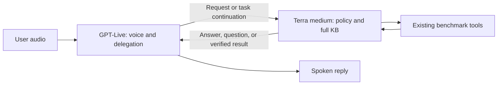

# GPT-Live prompt-optimized: proposed experiment

**Status: design approved to proceed September 16, 2026; implementation and pilot validation are in the [experiment protocol](../gpt-live-optimized-2026-09-16/PROTOCOL.md).**

The text below preserves the September 15 review draft. The draft files are separate
from every active benchmark configuration. The standard-prompt GPT-Live and
Gemini medium captures completed with their original prompts. No optimized conversations or results
have been added to the dataset.

## Runtime prerequisite discovered during the standard campaign

A short backchannel can currently let the playback gate commit a turn immediately
at input end. An isolated [fix and regression test](../speech-v2-live-medium-2026-09-15/live-gate-fix/README.md)
passed, and the fix is now applied. The user-approved [fresh standard cohort](../gpt-live-fixed-gate-n25-2026-09-15/PROTOCOL.md)
is running. Any optimized-prompt cohort must use that same corrected adapter. Otherwise an apparent
prompt improvement could come from the timing fix. The draft prompts remain unchanged.

## Proposal

### Evaluation follow-up: interim responses

The [interim-response and reconstruction proposal](INTERIM-RESPONSES.md) covers
spoken progress during delegation, separate backend versus delivered-answer
evaluation, first-speech versus substantive-response latency, and listening/ASR
validation. It includes an extracted recorded example. Richer turn coordination
and transcript reconstruction would constitute an additional evaluation-method
change; both prompt variants need the same method for a causal prompt comparison.
The following prompt-only design and current standard cohort remain frozen.

Create a separate entry named **GPT-Live prompt-optimized**. Give the Live frontend
a small voice/delegation prompt, and give its existing Responses backend the task
policy and the entire unchanged event knowledge base. Preserve the benchmark's
behavioral requirements, not the standard prompt's placement or exact phrasing.

Use `gpt-live-1` with `gpt-5.6-terra`, medium backend reasoning, Marin voice, and
Responses delegation. Keep the same questions, user audio, five tool schemas and
simulated results, recovery policy, playback gate, timeouts, and revised Opus 5
judge. The treatment is the prompt split and wording. Do not tune the backend model,
reasoning effort, service tier, or playback heuristic in the same comparison.

The optimized row must remain visibly separate from the same-prompt model table's
standard GPT-Live result. Report both voice and backend model identities. This is
benchmark-informed application optimization, not a fresh estimate of how GPT-Live
performs with the common frontend prompt.

## What the official guidance changes

OpenAI recommends a compact frontend prompt centered on conversational behavior
and concrete delegation conditions, with detailed procedures assigned to the
backend. It gives named policy sections for backchannels, interruptions, and
handoffs, and advises adding optional controls only when needed.
[GPT-Live prompting guide](https://developers.openai.com/api/docs/guides/live-prompting)

Responses delegation supplies conversation context to a configured backend and
returns its results to Live. Backend completion alone does not establish that the
user heard the answer. Tool configuration does not force frontend delegation.
[Delegation and tools](https://developers.openai.com/api/docs/guides/live-delegation)

**Our design inference:** move the KB and task procedures entirely behind the
backend handoff, and make continuation replies and session closure explicit routing
conditions. Do not assume that a short frontend prompt, or better backend answers,
automatically improves the actual spoken conversation.

## Draft artifacts

- [Frontend prompt](frontend.txt): 330 words; voice behavior, capabilities, and
  delegation conditions. No event-program entries, workflow checklists, tool
  schemas, or benchmark answers.
- [Backend instructions](backend-instructions.txt): 685 words of task policy and
  voice-context guidance, separate from the KB for easier review.
- [Complete backend prompt](backend.txt): 6,031 words including the **entire** KB.
- [Renderer](render.py): appends the source KB unchanged; makes no API calls and
  registers no benchmark. [Draft manifest](draft-manifest.json) records hashes.

These are word counts, not claims about the model's tokenizer or context limit.
The KB SHA-256 is `4fd37f8bfe733810a6cf246fa6e37372d225f6c60342a495f8177fa8a62f9593`,
matching the standard benchmark. Do not extract a hand-picked subset of the KB.

## Responsibility boundaries

### Frontend

The frontend manages delivery: listening acknowledgments, interruptions, brief
clarifications, and natural presentation of results. It may handle greetings,
capability questions, clearly unrelated requests, and repetition of still-applicable
verified information without delegation. It does not invent new event facts or
perform KB reasoning from memory.

Delegation must cover **continuations**, not just fresh questions. A name, revised
date, preference, or short acceptance can supply the last required piece of an
already-authorized task. The frontend should send that to the backend even when it
could produce a polite acknowledgment locally.

A clear intention to finish is also a backend task. The frontend routes it before
its final farewell. Merely saying goodbye does not execute `end_session`. A casual
thanks during an ongoing task remains different from a goodbye; the prompt preserves
that distinction without prescribing exact closing words.

### Backend

The backend applies the event policy, reads the full KB, interprets task state,
collects genuinely missing details, and selects tool calls. It returns a concise
answer, necessary question, or honest limitation for the frontend to express. Tool
success is established by the actual tool result, not by a promise in either model's
text.

Use natural-language backend results in the first version. Do not introduce a new
JSON response envelope, parser, client-managed memory, or extra model that rewrites
answers. Those would add another experimental variable. Preserve required details
in frontend paraphrasing, especially recommendation titles, speakers, dates, times,
and limitations on unsupported requests.

The frontend receives short routing guidance; detailed tool-use procedures and
schema-specific argument requirements belong only in the backend and existing tool
configuration. The frontend's capability list does not give it a separate set of
tools or a new API to invoke.

## Policy equivalence checklist

| Standard speech-v2 requirement | Placement in the proposal |
|---|---|
| Friendly, concise voice; respond to the actual request | Frontend delivery and backend response contract |
| Event scope; discussion of the conversation and capabilities | Both roles; backend owns nuanced event limitations |
| KB-grounded facts; no invented routes or missing information | Backend facts/scope policy; frontend waits for verified results |
| Differentiate unrelated requests from unsupported event requests | Frontend may redirect obviously unrelated requests; backend supplies contextual limitations |
| Reuse known name, preferences, dates, and interests | Backend memory policy; frontend routes continuation replies |
| Latest correction wins | Frontend hands off corrections; backend updates its interpretation |
| Act once authorized and arguments are known; avoid redundant confirmation | Backend tool procedure |
| Wait if a question/offer still requires the user's answer | Both roles |
| Confirm success only after execution; avoid duplicate actions | Backend tool results and frontend verified-result rule |
| Dietary requests, suggestions, voting, concrete support issues | Backend; same five tool schemas |
| Resolve session IDs from the KB | Backend voting procedure |
| Close only on a clear intention to finish | Frontend delegation condition plus backend `end_session` rule |
| Establish interests, date, and attendance window before recommendations | Backend recommendation procedure |
| Two recommendations, each with title, speaker, date, and time | Backend output requirements; frontend retains required details |
| Include all relevant entries for a speaker; overview for a general track/topic | Backend KB-question policy |
| Do not infer totals of sessions, speakers, or topics | Backend policy, unchanged in substance |

No turn numbers, golden responses, expected session IDs, or scripted attendee names
are embedded in either prompt. The frontend has no special MCP rule; all such
questions use the general factual/reasoning handoff.

## Delegation examples to review

These describe categories, not required scripts or benchmark-specific answers.

| Situation | Intended behavior |
|---|---|
| New event schedule or speaker question | Delegate before answering from the KB |
| User asks to hear the same verified answer again | Repeat locally without extra lookup |
| Backend asked for the attendee's name; user supplies it | Delegate the continuation; do not stop at acknowledgment |
| User accepts an offered dietary submission | Delegate; backend resolves authorization and reuses known arguments |
| User corrects their attendance date | Delegate the changed constraint before new recommendations |
| “Yes” has no clear referent | Ask a brief clarification; do not invent authorization |
| User clearly finishes the conversation | Delegate closure before final farewell |
| User briefly thanks the assistant while a task continues | Acknowledge without closing |
| User asks for unavailable event navigation | Delegate; backend explains the event-specific limitation |
| Unrelated general-knowledge request | Brief scope redirect locally |

## What existing evidence suggests—and does not prove

The six previously validated standard-prompt GPT-Live conversations all omitted
`end_session`; the first full validation's final turn had no backend delegation.
That is evidence for investigating the routing boundary, not proof that a prompt
change will fix it. See the [saved validation](../gpt-live-readiness-2026-09-15/rejudged/VALIDATION.md).

The earlier custom-frontend probes are not a valid optimized baseline: they used
different exploratory instructions, included an incomplete conversation, and were
excluded from the standard results. This design starts a named, versioned experiment
rather than relabeling those probes.

Likely benefits: less irrelevant frontend context, clearer responsibility for task
state, and explicit routing of action continuations and closing requests. Possible
costs: more backend calls for factual questions, longer substantive-answer latency,
and loss of details when Live paraphrases a correct backend response. Managed
conversation context may also omit information needed for a later action; a prompt
cannot guarantee complete memory.

## Small investigations before a full experimental cohort

1. **Prompt/config integrity.** Confirm the session acknowledges distinct frontend
   and backend instructions, with the full exact KB only in the backend. Keep all
   other settings identical. This checks API wiring, not behavior.
2. **Continuation handoff.** In a short synthetic conversation, provide a name,
   answer a follow-up, accept an offered action, and later reuse the known name.
   Inspect delegation events, actual arguments/results, and spoken confirmation.
3. **Closure handoff.** Contrast a clear goodbye with a thanks inside an unfinished
   task. Check the actual tool call, not just farewell speech or backend prose.
4. **Factual output and correction.** Ask an event question, request repetition,
   then change an attendance constraint. Check grounded content and routing.
5. **Delivery fidelity.** Verify that a backend recommendation's required details
   survive into played audio. A correct unspoken backend answer does not earn credit.

Use fresh synthetic wording and details, not hidden turn-index instructions. Retain
all probe outputs under their own prompt hashes; exclude them from canonical
results. The configuration-only [acceptance probe](acceptance-probe.json) passed:
GPT-Live acknowledged both distinct prompts byte-for-byte, then the session closed
without audio or tools. The renderer also verifies full-KB inclusion. This confirms
direct SDK acceptance, not the proposed benchmark adapter wiring or model behavior.
The behavioral probes above remain proposed, not claimed successes.

Open questions for review:

- Is the proposed local-versus-backend boundary narrow enough, especially for short
  replies and factual reuse? Recommendation: start with the boundary above and
  inspect its actual delegations before expanding local answering.
- Are moderate backchannels desirable for this workload? Recommendation: begin
  with the guide-aligned behavior. Keep the same overlap metric and report listening
  sounds; do not silently exempt them from the benchmark's audio assessment.
- Does managed Responses context preserve earlier user facts adequately? Test it.
  If it does not, treat client-managed memory/delegation as a separate follow-up
  experiment rather than silently changing this prompt-only comparison.

## Implementation after design review

Use a separate benchmark/config ID, proposed `aiwf_medium_context_speech_live_optimized`,
with separate `frontend_system_instruction` and `backend_system_instruction` values.
The adapter currently passes one shared string to both locations; a small explicit
opt-in is needed to select the split. The standard benchmark must retain its exact
existing string and remain the default. Do not edit the active adapter while the
current frozen campaign is running.

Import the same question/audio/tool definitions and the same revised speech judge.
The judge continues to evaluate the shared **behavioral contract**, not whether the
optimized frontend contains the original long prompt. Preserve the live/backend
prompt texts, hashes, model/effort/voice, dependency versions, and source hashes in
each experimental run. Verify the session echo of both prompts.

Keep the application's existing simulated tool handler and duplicate handling. Do
not add an authorization filter that repairs a model's wrong action before scoring;
that would mask the behavior being compared. Production permission controls remain
an application concern, separate from this prompt experiment.

## Evaluation and reporting

After review and successful probes, freeze one prompt version before a proposed
25-attempt cohort. Preserve incomplete attempts and the fixed 750-turn denominator.
Use the same revised Opus 5 judge and audio analysis as standard GPT-Live. Report
strict accuracy, each scoring dimension, reliability, measurement coverage, and
per-turn V2V. Keep every version's results instead of selecting favorable reruns.

Add diagnostics for delegation count, missing required handoffs, backend/tool timing,
and spoken-versus-backend discrepancies. Keep primary V2V defined as user-speech end
to first actual assistant speech. A quick acknowledgment can hide slower substantive
answers, so separately inspect time to the useful answer and time to action completion
with audio/transcript evidence. Do not label backend completion time as spoken-answer
latency. Annotations for this secondary measure need a documented definition before
aggregation.

Compare against a validated 25-attempt standard GPT-Live cohort using the same corrected gate, with uncertainty
intervals and disclosure that captures occurred at different times. The separate
single standard validation remains outside that comparison. Treat any gain as the
result of this prompt/architecture fit on this workload, not evidence that all voice
agents or all models would gain the same amount.
